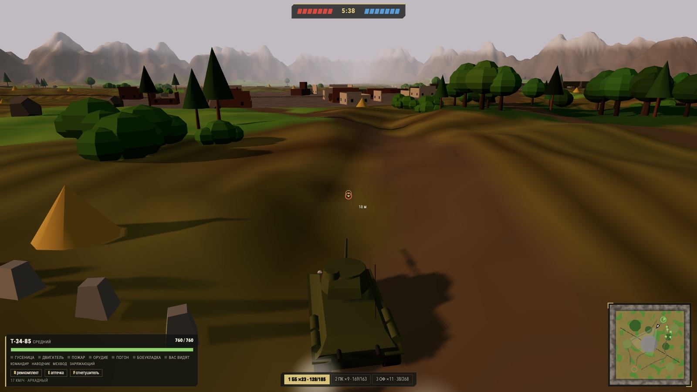
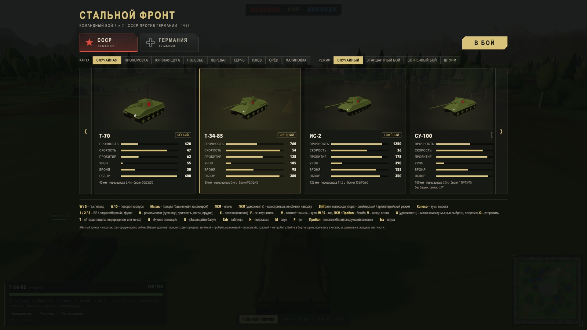
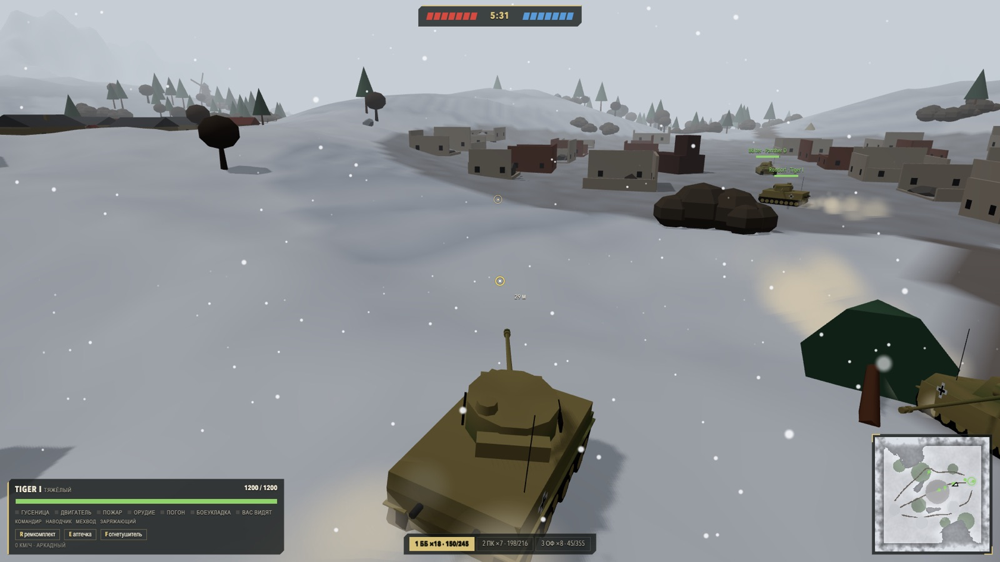
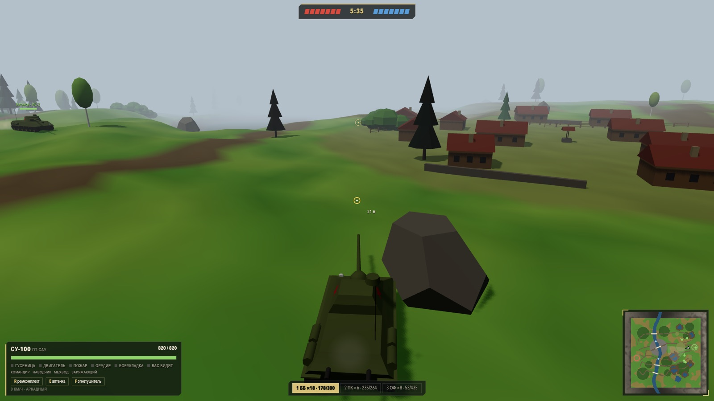
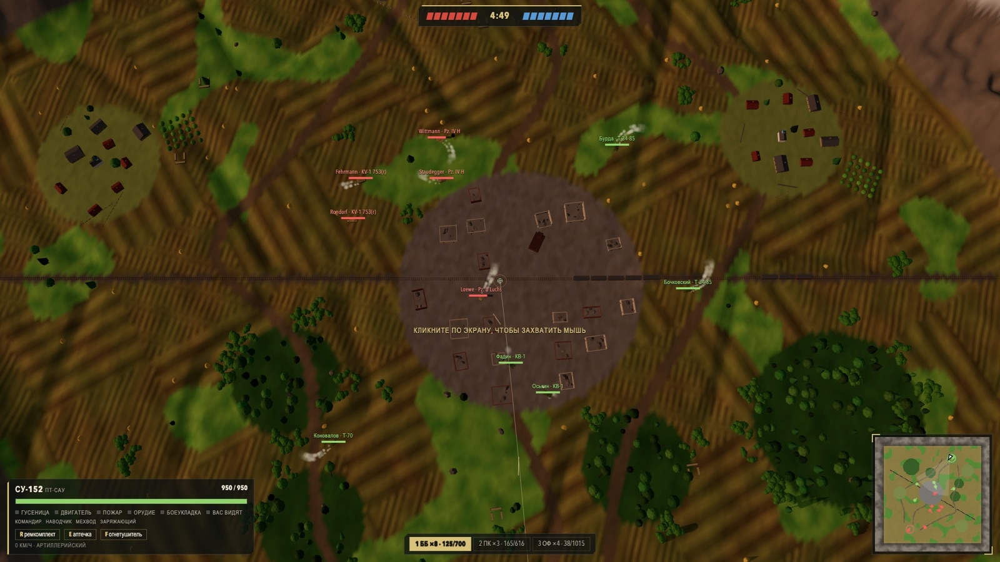

# Steel Front — browser tank battles

[](https://github.com/miksrv/tanks-web-arena/actions/workflows/checks.yml)
[](https://github.com/miksrv/tanks-web-arena/actions/workflows/deploy.yml)
[](https://github.com/miksrv/tanks-web-arena/releases)
[](LICENSE)

**Steel Front** (Стальной фронт) is a free 3D tank game that runs in the browser: team battles 7 vs 7 in the spirit of World of Tanks, **USSR vs Germany, 1943**. Built with **Three.js, TypeScript and Vite**, no external assets: every map, village, ruined town, tank and sound is generated procedurally. Single player against bots, nothing to install.

**Play now:** [tanks.miksoft.pro](https://tanks.miksoft.pro) (desktop browser, mouse and keyboard; the game UI is in Russian)



|                                                                   |                                                                   |
| ----------------------------------------------------------------- | ----------------------------------------------------------------- |
|     |  |
|  |         |

## Features

- **Three game modes**: Standard (a base on each side), Encounter (one neutral base) and Assault (one side defends). Two teams of 7, no respawn, 6-minute rounds, WoT-style base capture.
- **A new map every battle**: 900 × 900 m, five terrain types (central Russia, steppe, swamps, mountain pass, coast), eight named maps, seven kinds of weather and time of day, three seasons. Rivers with bridges and fords, railways, villages, a ruined town or a factory district, pillboxes, Czech hedgehogs, forests where trees fall under your tank.
- **28 historical vehicles** in five classes: light, medium and heavy tanks, tank destroyers and SPGs. T-34, KV-1, IS-2, SU-152, Katyusha; Pz. IV, Panther, Tiger I, StuG III, Ferdinand, Nebelwerfer and more. Each has its own armour layout, gun, speed, view range and camouflage.
- **World of Tanks style armour model**: hull and turret plates by projection, impact angle, normalisation, ricochet, the three-calibre rule, weak zones (lower glacis, cupola, mantlet), side skirts against HE. Three shell types: AP, APCR, HE with splash.
- **Modules and crew**: tracks, engine, turret ring, gun, ammo rack (with detonation), fire; wounded commander, gunner, driver and loader. Repair kit, first aid kit and fire extinguisher. Ramming.
- **Spotting**: view range vs camouflage, line of sight through terrain and buildings, bushes and forests, shared team vision, sixth sense. Unspotted enemies are not drawn.
- **Team bots with roles**: scouts spot from bushes, strike groups push lanes together, tank destroyers cover from high ground, SPGs fire from the rear at spotted targets. Bots pick shells by target armour, angle their hull and retreat when low.
- **Arcade, sniper and artillery views**, a reticle coloured by penetration chance, a reload ring, a gun marker that shows where the shell will really land, an artillery trajectory and dispersion ellipse.
- **Battle feedback**: ribbons, medals, hit log, scoreboard, minimap, hit direction indicator, a post-battle report in the garage, team signals to bots, procedural sound with stereo panning.

## Controls

| Key             | Action                                                                               |
| --------------- | ------------------------------------------------------------------------------------ |
| W / S, A / D    | throttle / reverse, hull turn                                                        |
| Mouse, LMB      | aim (the turret follows the camera), fire                                            |
| RMB (hold)      | look around without disturbing the aim                                               |
| Shift / wheel   | sniper mode (SPG: top-down artillery view) / zoom and camera distance                |
| 1 / 2 / 3       | AP / APCR / HE                                                                       |
| R / E / F       | repair kit / first aid kit / fire extinguisher                                       |
| Q (hold)        | team signal menu; T / G / B send Attacking! / Need help! / Defend the base! directly |
| Tab / H / M / P | scoreboard / help / sound / fps                                                      |
| Space           | after death: next ally                                                               |
| Esc             | pause and release the mouse; click to continue                                       |

## Tech stack

- [Three.js](https://threejs.org/) for rendering, [TypeScript](https://www.typescriptlang.org/), [Vite](https://vite.dev/)
- No game engine, no models, textures or audio files: terrain, buildings, vehicles, particles and sound are generated in code
- A static site: the build is one `index.html` and one bundle, hosted on plain shared hosting
- ESLint, Prettier and GitHub Actions for checks and deployment

## Getting started

```bash
git clone https://github.com/miksrv/tanks-web-arena.git
cd tanks-web-arena
npm install
npm run dev      # http://localhost:5181
npm run build    # tsc + vite build → dist/
```

Useful URL parameters for testing: `?autostart&seed=N&tank=t34_85&map=steppe&mode=encounter&weather=fog&speed=2&debug` (see `src/game/testHooks.ts` for the full list).

## Project structure

```
src/
  main.ts       entry point
  config/       all game numbers: vehicles (one file per vehicle), guns, shells, combat, bots, match, world
  core/         math, noise, spatial grid
  game/         game loop, match flow, player controller, spotting, capture, medals, battle report
  world/        procedural terrain, rivers, roads, railways, villages, towns, props
  tank/         tank state, movement, suspension, crew, modules, ammo, hit boxes, procedural models
  combat/       armour model, shells, ballistics, tracing
  ai/           bot core, team tactics and per-class roles
  render/       renderer, environment, adaptive resolution
  hud/          garage, reticle, minimap, ribbons, scoreboard
  fx/           particles, ground marks, precipitation, procedural audio
  plane/        the player's aircraft prototype
docs/mechanics/ the rules and numbers behind combat, tanks, the world, spotting and bots
docs/TODO-*.md  deferred plans: progression and a client-server mode
```

## Development

```bash
npm run typecheck   # tsc --noEmit
npm run lint        # ESLint (typescript-eslint, type-aware)
npm run format      # Prettier
npm run check       # typecheck + lint + format:check, run before committing
```

Every pull request runs `npm run check` and a build in GitHub Actions. A push to `main` deploys the build to the hosting over FTP (`.github/workflows/deploy.yml`, secrets `FTP_HOSTNAME`, `FTP_USERNAME`, `FTP_PASSWORD`).

Releases follow [CHANGELOG.md](CHANGELOG.md): every version bump gets a section there and a `vX.Y.Z` tag with a [GitHub release](https://github.com/miksrv/tanks-web-arena/releases).

## License

[MIT](LICENSE).
